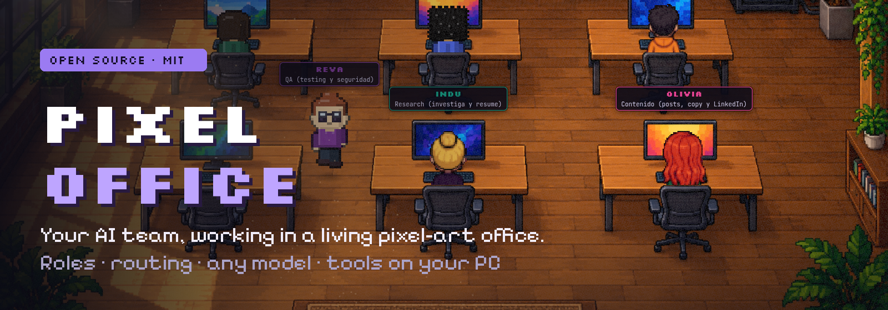
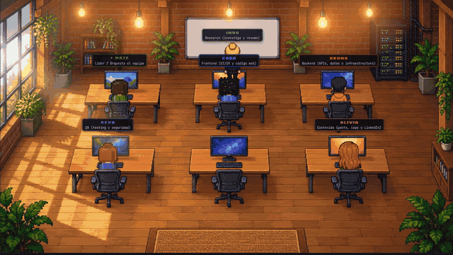
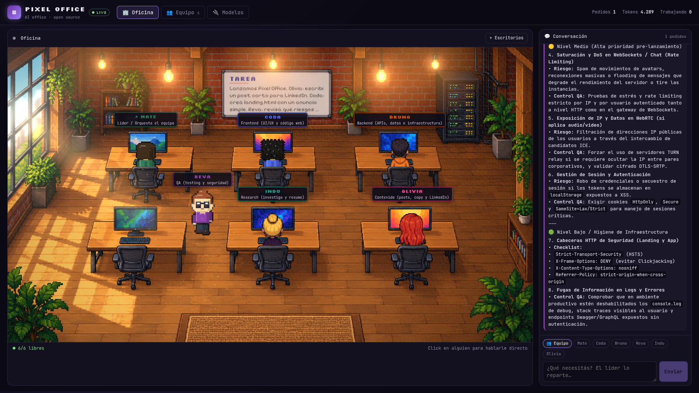

<p align="center">
  
</p>

<p align="center">
  <a href="LICENSE"></a>
  
  
  
  
  
</p>

<p align="center">
  <a href="#quick-start">Quick start</a> ·
  <a href="#what-it-does">Features</a> ·
  <a href="#how-routing-works">How it works</a> ·
  <a href="#security">Security</a> ·
  <a href="#author">Author</a>
</p>

---

**Pixel Office** is an open-source pixel-art office where AI agents work as a team.

Add people to the office, give each one a **role, a prompt and a model**, and write what you need. The lead reads your message, decides who it belongs to and walks over to their desk to hand it off. They type it out live on their monitor while the answer streams into the chat, and when someone needs to touch your computer, they ask first.

<p align="center">
  
</p>

<p align="center">
  
</p>

## What it does

- **A living office.** A painted pixel-art scene rendered in 2.5D with Three.js: procedural animated characters walk between desks, type, think and get up for a coffee. Bloom on flickering lamps, sun rays with floating dust, glowing monitors that scroll code while someone works, papers flying when the lead hands off a task, sparkles when someone finishes, and the current task on the whiteboard.
- **Real routing.** You write to the team; the lead (★) returns a structured plan of who does what, and each assignee works in parallel on their part only. Click anyone in the office to talk to them directly.
- **They can work on your computer.** Flip “🖥 Puede usar la PC” on a person and they get tools: list, read, search, write, edit files and run commands in a workspace folder. Reading inside the workspace is automatic; every write, edit or command pops a permission dialog (Permitir · Siempre · Denegar) unless you turn on *modo libre*. The lead knows who has PC access and routes hands-on tasks to them.
- **Editable team.** Hire, fire and edit people: name, role, prompt, provider, model and desk. Each one starts as a procedural chibi (walks, types, blinks; pick skin, hair, outfit, glasses, headphones) or press **🎨 Dibujar con IA**, describe them, and an image model draws them in the office's style.
- **Any model.** Anthropic, or any OpenAI-compatible API: OpenAI, OpenRouter, Ollama, LM Studio, vLLM, a local proxy. Mix providers per person. A built-in **Demo** provider works with no key.
- **Your keys stay on your server.** Keys live in `data/office.json` (gitignored) or in env vars, and are never sent to the browser.

## Quick start

You need Node 20+.

```bash
git clone https://github.com/gonzalonicolasr/pixel-office
cd pixel-office
npm install
npm run dev
```

Open http://localhost:5173. It boots with the Demo provider so you can play right away. Then go to **🔌 Modelos** to plug in a real model, and **👥 Equipo** to assign it.

Optional env vars:

| Variable | What |
|---|---|
| `ANTHROPIC_API_KEY` | If set on first run, the default team uses Claude |
| `OPENAI_API_KEY` | Picked up by the default OpenAI-compatible provider |
| `PORT` / `HOST` | API server (default `127.0.0.1:8787`) |
| `DATA_DIR` | Where `office.json` and generated looks live (default `data/`) |
| `OFFICE_WORKSPACE` | Default workspace folder for agents with PC access (default: your home) |
| `OFFICE_ALLOWED_ORIGINS` | Extra origins/hosts allowed to call the API (comma separated) |

Production: `npm run build && npm start` serves the app and the API from one port.

### Drawing people with AI

In **Modelos → Ajustes** pick an image provider and model. Anything that returns images from `/chat/completions` (Gemini image models, OpenRouter image models) or `/images/generations` (OpenAI `gpt-image-1`) works. The app asks for a three-pose sprite sheet on a magenta background, keys it out in the browser and uses it for standing, walking and sitting.

### Security

Agents with PC access run with **your** user permissions. Pixel Office is meant to run on your own machine:

- The API listens on `127.0.0.1` and rejects requests whose `Origin` or `Host` isn't localhost, so a random website can't drive it. If you deliberately expose it, list allowed origins in `OFFICE_ALLOWED_ORIGINS`.
- Writes, edits and commands require your approval in the UI unless *modo libre* is on. "Siempre" remembers a tool for that person until the server restarts.
- Commands time out after 120 s. Output sent to the model is truncated.
- API keys live in `data/office.json` (mode 600, gitignored) or env vars and never reach the browser.

### Using a local model (Ollama)

In **Modelos**, add a provider of type *OpenAI-compatible* with base URL `http://localhost:11434/v1` and no key. Then set a person's model to e.g. `llama3.1`.

## How routing works

```
you ─► lead (★) ──JSON plan──► { note, assignments: [{agent, task}] }
                     │
                     ├─► Olivia  (only her part) ──stream──► chat + typing at her desk
                     └─► Reva    (only her part) ──stream──► chat + typing at her desk
```

If the lead decides nobody else is needed, it answers itself. Each person keeps a short memory of their own conversation.

## Your own office

The background is a single image: `public/office/office-bg.png`. Swap it for any office you like (AI-generated works great; ask for *empty desks, chairs facing away from the viewer, no people, no text*). Then press **✥ Escritorios** in the office and drag the numbered markers onto each chair. Lamp glows, the whiteboard and wander spots are optional fields of `layout` in `data/office.json`.

## Project layout

```
server/        Node API: providers (Anthropic / OpenAI-compatible / demo), lead routing, SSE events, JSON store
src/office/    engine (pathing, actions, state) + Three.js renderer (bloom, rays, screens, particles) + sprite painter
src/components chat, team editor, model editor
shared/        types shared by server and web
tests/         vitest
```

## Roadmap

- Web browsing tool
- Agents handing work to each other and reviewing each other's output
- Persistent task board and history
- More animations (celebrate, meeting at the whiteboard) and furniture-aware pathing

## Author

Built by **Gonzalo Rocca**, a backend engineer from Argentina who builds AI tools in public.

<p>
  <a href="https://gonzalorocca.com"></a>
  <a href="https://www.linkedin.com/in/gonnicolas/"></a>
  <a href="https://x.com/gnrocca"></a>
  <a href="https://github.com/gonzalonicolasr"></a>
</p>

If you build something with it, I'd love to see it. Issues and PRs are welcome.

## License

[MIT](LICENSE) © Gonzalo Rocca
